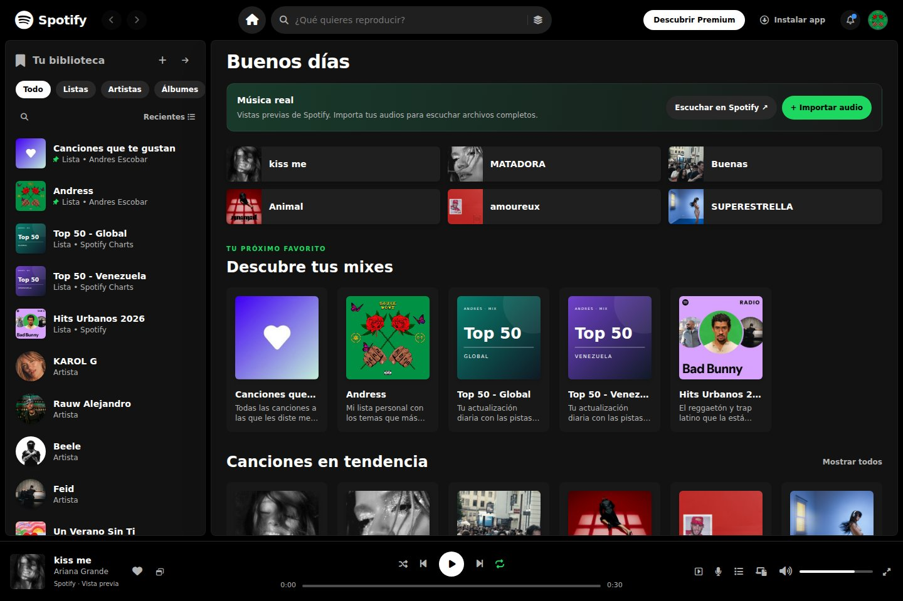

<div align="center">

# 🎧 Spotify Web Player · Andrés Escobar

**Una interfaz musical responsive con audio real, tarjetas visuales y biblioteca personal.**

[](https://developer.mozilla.org/es/docs/Web/HTML)
[](https://developer.mozilla.org/es/docs/Web/CSS)
[](https://developer.mozilla.org/es/docs/Web/JavaScript)
[](https://tailwindcss.com/)

### [Abrir Live Demo ↗](https://andresescobar14.github.io/Proyecto-Spotify-Andres/)

Proyecto educativo e independiente. No es el sitio oficial de Spotify.

</div>



## Qué puedes hacer

| Función | Comportamiento |
| --- | --- |
| Música real | Escucha vistas previas oficiales de las 17 canciones del catálogo. |
| Spotify integrado | Abre el reproductor oficial de la canción seleccionada dentro de la página. |
| Archivos completos | Importa audios propios desde tu equipo y escúchalos con los controles de la página. |
| Explorar | Descubre mixes, canciones, artistas, álbumes y emisoras con tarjetas e imágenes. |
| Buscar | Filtra por título, artista, álbum o género, sin recargar la página. |
| Reproductor | Usa play/pausa, anterior/siguiente, progreso, volumen, silencio, aleatorio y repetición. |
| Biblioteca | Filtra colecciones, guarda favoritos y crea listas vacías. |
| Responsive | Interfaz adaptada a móvil, tableta y escritorio, con biblioteca desplegable en móvil. |

## Cómo escuchar

### Vistas previas reales

Haz clic en una tarjeta de canción o en el botón de reproducción inferior. Cada grabación corresponde al identificador de esa canción en Spotify; se eliminaron los audios genéricos de demostración.

**El reproductor de la página reproduce fragmentos cortos, normalmente de hasta 30 segundos, no canciones comerciales completas.** La barra inferior muestra la duración del fragmento que está sonando. Las listas muestran la duración de la canción original.

La disponibilidad de los fragmentos depende de Spotify y de la conexión a internet. Si una fuente falla, la página avisa y no la sustituye por otra grabación.

### Reproductor oficial de Spotify

1. Selecciona una canción del catálogo.
2. En Inicio, pulsa **Escuchar en Spotify ↗** (también disponible en el control de Spotify de la barra inferior en escritorio).
3. Pulsa reproducir dentro del widget oficial.
4. Para continuar en la plataforma, utiliza **Abrir canción en Spotify ↗**.

La duración que permite el widget depende de Spotify, la cuenta, el navegador y la región; puede ofrecer solamente una vista previa. Para una integración de reproducción completa con el Web Playback SDK se requieren configuración de aplicación, autorización de usuario y Spotify Premium.

Al abrir el widget se pausa el audio de la página. Al cerrarlo o volver a reproducir desde la página, se elimina el widget para evitar dos audios simultáneos. Los controles del widget pertenecen a Spotify y no se sincronizan con la barra inferior de la página.

### Tus archivos completos

1. En Inicio, pulsa **+ Importar audio**.
2. Selecciona uno o varios archivos MP3, WAV, OGG, M4A o FLAC compatibles con tu navegador.
3. Los archivos aparecen en **Tus archivos de audio** y el primero empieza a reproducirse.

Los archivos se leen con URLs temporales del navegador: **no se suben al repositorio ni a ningún servidor**. Están disponibles mientras esa página permanezca abierta; al recargar debes seleccionarlos otra vez. La compatibilidad exacta de formatos depende del navegador.

Para añadir una canción propia permanentemente al sitio, guarda el archivo autorizado en `assets/audio/` y añade su objeto a `songs` en `js/data.js`:

```js
{
  id: 'song-propia',
  title: 'Mi canción',
  artist: 'Mi artista',
  artistId: '',
  album: 'Mi álbum',
  albumId: '',
  duration: 180,
  durationFormatted: '3:00',
  cover: 'assets/covers/placeholder.svg',
  audioUrl: 'assets/audio/mi-cancion.mp3',
  isLocal: true,
  isLiked: false,
  genre: 'Pop',
  plays: '—',
  lyrics: []
}
```

## Ejecutar en tu equipo

### Opción recomendada: servidor local

```bash
git clone https://github.com/andresescobar14/Proyecto-Spotify-Andres.git
cd Proyecto-Spotify-Andres
python -m http.server 8080
```

Abre **http://localhost:8080**. En Windows puedes utilizar `py -m http.server 8080` si el comando `python` no está disponible.

### Opción con Visual Studio Code

Abre la carpeta del proyecto, instala la extensión **Live Server** y selecciona **Open with Live Server** sobre `index.html`.

El sitio incluye el CSS compilado, las portadas y los iconos. **No necesitas npm para verlo.** La fuente Inter se solicita a Google Fonts; si no carga, se utiliza una fuente de sistema. El audio remoto y el widget necesitan internet.

## Desarrollo

Requiere Node.js 18 o posterior y npm para ejecutar las pruebas y regenerar los estilos:

```bash
npm ci
npm run check
npm test
npm run build:css
```

| Comando | Para qué sirve |
| --- | --- |
| `npm run check` | Comprueba la sintaxis de los archivos JavaScript. |
| `npm test` | Ejecuta las pruebas del reproductor y del catálogo. |
| `npm run build:css` | Genera `assets/utilities.css` desde las clases de HTML y JavaScript. |

Después de cambiar clases de Tailwind, vuelve a generar el CSS y guarda el resultado en el commit. El sitio no ejecuta Tailwind mediante un CDN en producción.

## Organización del proyecto

| Ruta | Contenido |
| --- | --- |
| `index.html` | Estructura principal, navegación, reproductor, paneles e importación de archivos. |
| `styles.css` | Layout responsive, tarjetas, controles y estados visuales. |
| `js/data.js` | Catálogo, identificadores de Spotify, vistas previas y almacenamiento de preferencias. |
| `js/player.js` | Audio HTML5, cola, volumen, progreso y modos de reproducción. |
| `js/app.js` | Vistas, búsqueda, eventos, biblioteca, widget e importación local. |
| `assets/covers/` | Portadas locales del catálogo y gráficos de las listas. |
| `assets/icons/` | Iconos y fuentes de Font Awesome incluidos localmente. |
| `assets/utilities.css` | CSS de Tailwind compilado. |
| `assets/tailwind.css` | Entrada para compilar Tailwind. |
| `tailwind.config.cjs` | Configuración de generación de estilos. |
| `tests/player.test.cjs` | Pruebas automatizadas. |
| `docs/screenshots/` | Capturas de la interfaz. |

## Publicar y actualizar el Live Demo

1. En el repositorio, abre **Settings → Pages**.
2. Selecciona **Deploy from a branch**, rama **main** y carpeta **/(root)**.
3. Guarda la configuración.
4. Cuando haya cambios en otra rama, abre su pull request y pulsa **Merge pull request → Confirm merge**.
5. En **Actions**, espera a que **pages build and deployment** termine correctamente.
6. Abre el [Live Demo](https://andresescobar14.github.io/Proyecto-Spotify-Andres/) y presiona **Ctrl + Shift + R**.

Subir una rama de trabajo no actualiza por sí solo la demo: los cambios deben integrarse en la rama que publica Pages.

## Comprobaciones

- Pruebas de almacenamiento bloqueado, favoritos persistentes, volumen inválido y restauración del silencio.
- Verificación de repetición, límites de progreso y promesas de reproducción interrumpidas.
- Verificación de 17 fuentes oficiales distintas, duración de los fragmentos y ausencia de audios de demostración.
- Comprobación de errores de fuente y aviso previo para detener un widget antes del audio nativo.
- Revisión de layout en 320, 375, 640, 768, 1024, 1440 y 1920 píxeles.

## Preguntas frecuentes

**¿Por qué la canción se detiene al poco tiempo?**
El catálogo utiliza vistas previas cuya duración puede variar según la canción. Para escuchar un archivo completo, importa tu audio; para la canción comercial, abre su reproductor oficial en Spotify.

**¿Por qué no se escucha?**
Pulsa reproducir, revisa el volumen y la conexión. Si el fragmento no está disponible, utiliza **Escuchar en Spotify**. Si es un archivo propio, prueba MP3 o WAV.

**¿Por qué no veo la última versión?**
Comprueba que el pull request esté integrado en `main`, que Pages haya terminado de publicar y recarga con **Ctrl + Shift + R** o abre una ventana de incógnito.

**¿Qué se guarda?**
Favoritos del catálogo, listas creadas y volumen se guardan en `localStorage`. Los audios importados no se guardan. Si el navegador bloquea el almacenamiento, la sesión sigue funcionando.

**¿Se conecta con mi cuenta de Spotify?**
La página no gestiona tu cuenta ni tus credenciales. El widget oficial funciona según las condiciones de Spotify. No se incluyen claves secretas ni tokens en el repositorio.

## Alcance y recursos

Este proyecto es una interfaz educativa, no una réplica del servicio completo. Las listas nuevas empiezan vacías; no incluye edición de sus canciones, autenticación propia, suscripciones, descargas ni conexión a dispositivos. Las colecciones, biografías y cifras de la maqueta no son un catálogo completo ni estadísticas en tiempo real. No se muestran letras inventadas como si pertenecieran a las grabaciones reales.

- [Documentación oficial de Spotify Embeds](https://developer.spotify.com/documentation/embeds)
- [Crear un reproductor integrado](https://developer.spotify.com/documentation/embeds/tutorials/creating-an-embed)
- [Web Playback SDK y requisitos](https://developer.spotify.com/documentation/web-playback-sdk/howtos/web-app-player)
- [Font Awesome Free: licencias](https://fontawesome.com/license/free)

Spotify, las portadas y las grabaciones pertenecen a sus respectivos titulares. El repositorio no incluye copias de las grabaciones comerciales completas ni concede derechos sobre ellas.

## Autor

**Andrés Escobar** · [@andresescobar14](https://github.com/andresescobar14)
